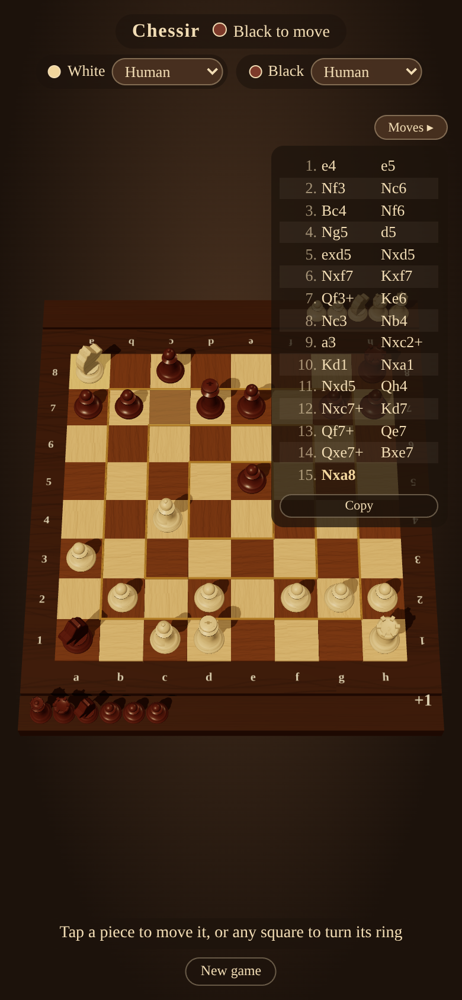
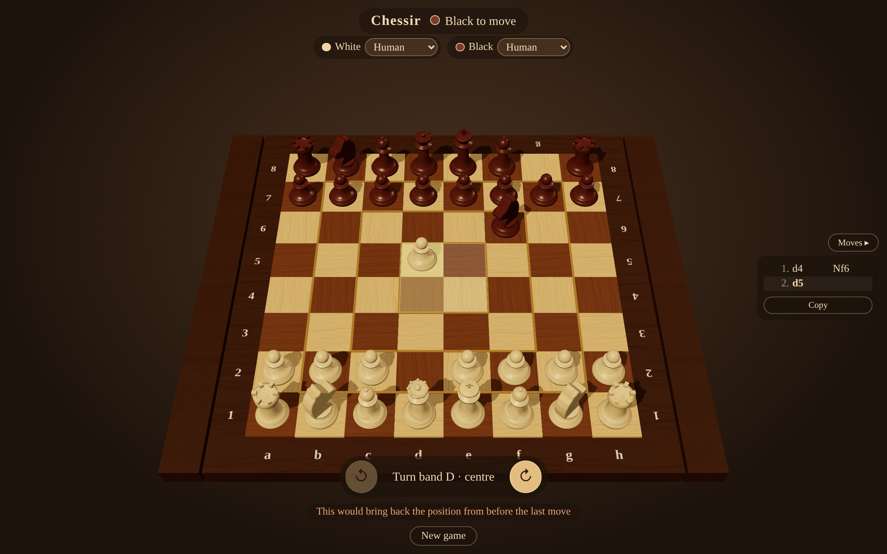
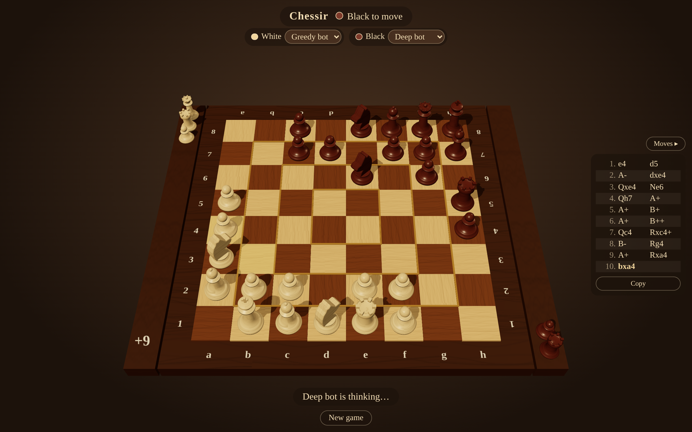

# Chessir

Chess where the board itself can turn. Rendered in the browser with [three.js](https://threejs.org/).

**Play it:** https://templarrr.github.io/chessir/


## Rules

All classic chess rules apply, plus one extra option. The board is split into four square
rings ("bands"): the outer ring of 28 squares, then 20, then 12, and the 4 central squares.
On your turn, instead of moving a piece you may rotate one band by one square in either
direction; every piece on that band travels with it.

While your king is in check you may not rotate a band that holds your king or the checking
piece. You may still escape check by rotating another band so that a piece lands between them.
As with any move, a rotation may never leave your own king in check.

A rotation may not undo your opponent's last move: you may not rotate a band if that would put
every piece back exactly where it stood before their move. That covers turning a band straight
back after your opponent rotated it, and also carrying a piece back with a rotation after it
moved one square along its band (say a lone pawn on the centre band steps d4-d5, and you turn
the centre so it lands on d4 again). Any rotation that leads somewhere new is fine. Without this
rule a game could stall forever with the same two positions taking turns.

Details that follow from the twist:

- Castling is allowed only if neither the king nor that rook has ever left its square, whether
  by a move or by riding a rotating band.
- En passant is possible only on the turn right after the double step.
- A pawn always moves toward the opponent's side. One carried onto its last rank by a rotation
  stays a pawn and cannot move forward until a rotation carries it off again; promotion happens
  only by moving there.
- An empty band cannot be rotated (that would be a "pass").
- Because of the no-undo rule, which rotations it blocks are part of the position when counting
  threefold repetition.
- The game ends in checkmate, or in a draw by stalemate, threefold repetition, the fifty-move
  rule, or when only the two kings remain.

## How to play

Pick who plays each side with the **White** and **Black** selectors at the top: a human or one
of the bots. Two humans play hot-seat on one screen; two bots play each other. The choice is
remembered and can be changed mid-game; if it is that side's turn, the new player takes over
right away. By default you play White against the greedy bot; pick the Deep bot for a real fight.

As a human:

- Tap one of your pieces to see where it can go (dots, or rings for captures), then tap the
  destination. Promotions ask which piece you want.
- Tap any square to select its band; use ↺ / ↻ at the bottom to turn that band one square
  counter-clockwise or clockwise (as seen from White's side). If the turn is not allowed, the
  reason appears under the buttons.
- Drag to orbit the camera, scroll or pinch to zoom.

Captured pieces stand on a ledge beside the board on the side of the player who took them,
most valuable first (queen, rooks, bishops, knights, pawns), so the material difference is easy
to see. The side that is ahead also gets a `+N` on its ledge, counted with the piece values
below (a promoted pawn counts as its new piece). On wide screens the ledges run along the left
and right of the board, to each player's right; on tall screens they sit in front of and
behind it.

The **Moves** button on the right shows or hides the game record; **Copy** puts it on the
clipboard as text, e.g. `1. e4 e5 2. Nf3 Nc6 3. A+ C- 4. Bxf7+`. The panel starts open on wide
screens and closed on phones, and remembers your choice.

| Phone                                                 | Phone, moves panel open                                      |
| ----------------------------------------------------- | ------------------------------------------------------------ |
|  |  |




## Notation

Normal moves use standard algebraic notation (`e4`, `Nbd2`, `exd6`, `O-O`, `e8=Q`).

A band rotation is written as the band's letter plus a direction. Each band is named after the
first file it covers: **A** is the outer ring (it covers file a), then **B**, **C**, and **D**
for the four central squares. `+` means the band's squares on that file move toward higher rank
numbers, `-` toward lower ones. Seen from White's side, `+` is clockwise (↻) and `-` is
counter-clockwise (↺). So `A+` carries the rook on a1 up to a2 and `D-` turns the centre so
that a piece on d5 goes to d4.

As with any move, `+` is added if the rotation gives check and `#` if it mates, so a rotation
that gives check reads `A++` or `B-+`. The copied record ends with `1-0`, `0-1` or `1/2-1/2`
once the game is over.

## Bots

**Greedy bot** looks one turn ahead. It tries every legal action (moves and rotations) and
picks the best by these priorities, in order:

1. Checkmate if it can.
2. The biggest material gain (captures; a promotion counts as the value it adds) minus the
   value of its own pieces left exposed afterwards. A piece is exposed if the opponent attacks
   it and it is undefended (counts in full) or defended but attacked by something cheaper
   (counts the difference). So it will not grab a pawn with its queen if the queen is then lost.
3. If that ties (typically when nothing can be captured), the best capture it lines up for its
   next turn, valued the same way.
4. If that also ties, pushing its pawns toward promotion: it prefers the action that leaves its
   pawns furthest advanced, counting each pawn's squares gained squared, so it keeps pushing its
   leading pawn rather than nudging a new one each turn. A rotation that carries a pawn forward
   counts too; a pawn carried onto its last rank, where it is stuck, counts for nothing. Because
   step 2 comes first, it never pushes a pawn where it can simply be taken unless something
   equal is won in return.
5. If that also ties, the most squares its pieces can move to afterwards.
6. If still tied, a random pick among the best.

It also avoids a draw by threefold repetition: an action that would repeat the position for
the third time ranks below every other one, so it is played only if nothing else is legal.
The exception is when the bot is behind on material (by the piece values below); then a draw
is a fine result and repetition is treated like any other move.

Piece values: pawn 1, knight 3, bishop 3, rook 5, queen 9.

**Deep bot** is the strong one. It searches ahead the way chess engines do, and band rotations
are ordinary moves to it, so it plans rotation tricks of its own and sees yours coming. It
thinks for up to 10 seconds per move (usually 4 to 8, less when the move is forced or it finds
a mate) in a background thread, so the board stays responsive meanwhile. About a third of its
moves are rotations.



How it works:

- **Search.** Alpha-beta minimax with iterative deepening: it looks 1 turn ahead, then 2, then
  3, and so on until its time is up, and plays the best move of the deepest search it finished
  (about 11 half-moves deep in the opening after 2.5 seconds on a laptop). Lines that cannot
  beat a move already found are cut off; unpromising moves get a shallower look (null-move
  pruning, late-move reductions). Positions already analysed are remembered, also from earlier
  turns, which matters here because rotations reach the same position many ways.
- **Quiet positions only.** At the end of each line it keeps playing captures until none are
  left (quiescence search), so it never judges a position in the middle of a trade. In check
  it looks at every reply, rotations included.
- **Scoring a position** (in pawns): material (pawn 1, knight 3.2, bishop 3.3, rook 5, queen
  9.5); piece placement (centralised pieces and advanced pawns are worth more); mobility (how
  many squares its pieces reach); pawn structure (passed pawns, doubled and isolated pawns,
  the bishop pair). A pawn carried onto its last rank by a rotation is stuck and counts for
  much less.
- **Rules.** It follows the full rule set: the no-undo rule, locked bands in check, castling
  rights lost by rotation, and draws. A draw counts as slightly worse than an even position,
  so it avoids repeating moves unless it is losing.

How it was chosen: several approaches played each other in bot-vs-bot matches
(`npm run match -- <botA> <botB> --games 40 --ms 200`, variants in `scripts/bots.js`). Each
match pairs games from the same random opening with colours swapped.

| Match (40 games, 0.2 s per move unless noted)               | Result for the first bot |
| ----------------------------------------------------------- | ------------------------ |
| Deep bot vs Greedy bot (20 games, 1 s per move)             | +20 =0 −0                |
| First search version vs Greedy bot (20 games, 0.1 s)        | +20 =0 −0                |
| First version vs Monte Carlo tree search                    | +40 =0 −0                |
| First version vs the same search scoring material only      | +36 =1 −3                |
| First version vs the same search never rotating             | +35 =5 −0                |
| First version vs the same search without pruning            | +23 =7 −10               |
| First version vs the same without classic king safety       | +12 =8 −20               |
| No king safety vs the same keeping its memory between moves | +10 =7 −23               |
| No king safety vs the same with mobility counted double     | +14 =7 −19               |
| Deep bot (all three changes) vs no-king-safety version      | +22 =8 −10               |
| Deep bot vs memory-only version                             | +18 =9 −13               |
| Deep bot vs first version (20 games, 1 s per move)          | +11 =3 −6                |

Monte Carlo tree search (scoring new positions by playing out captures, since random games of
Chessir say little) lost every game to alpha-beta. Classic chess king safety (penalising enemy
pieces next to the king) made the bot weaker, probably because rotations carry kings and
attackers around too much for it to mean anything, so it was dropped.

## Status

- [x] 3D board and pieces, scales to any window size
- [x] Piece moves and band rotation in the UI (hot-seat)
- [x] Rules enforcement (check, mate, special moves, draws)
- [x] Player picker: human or bot for each side
- [x] Greedy bot
- [x] Deep bot (alpha-beta search in a Web Worker)
- [x] Move record panel with copy to clipboard
- [x] Captured pieces beside the board, sorted by value, with the material difference

## Development

Requires Node.js 22.12 or newer.

```sh
npm install
npm run dev      # local server with hot reload
npm run check    # lint + tests + production build
npm run format   # auto-fix lint and formatting
```

Keep `docs/screenshots/` up to date whenever the look or the UI changes; the README and pull
requests show them.

Code style is enforced by [ESLint](https://eslint.org/) (correctness) and
[Prettier](https://prettier.io/) (formatting); CI fails if either complains.

## Code layout

- `src/game/` holds the rules and game state as plain data with no three.js or DOM
  dependencies, so it can be unit-tested and used by a computer player.
  `src/game/rules.js` holds move generation, the rotation rules and game-end detection.
  `src/game/notation.js` writes moves and rotations as text; `src/game/material.js` works out
  captured pieces and the material difference.
- `src/render/` turns that state into a three.js scene; `capturedView.js` draws the captured
  pieces' ledges.
- `src/ui/` holds page widgets outside the board, such as the moves panel.
- `src/players/` holds the players: `human.js` turns taps and button presses into actions,
  `greedy.js` is the greedy bot, `deep.js` runs the Deep bot in a Web Worker, and `index.js`
  lists what the side pickers offer. A new bot is a new file there plus one line in `index.js`.
- `src/engine/` is the Deep bot's engine: `position.js` is a fast mutable copy of the rules
  (tests check it matches `src/game/rules.js` move for move), `search.js` the search,
  `evaluate.js` the scoring and `worker.js` the Web Worker entry.
- `scripts/match.js` plays bot-vs-bot matches (`npm run match`), checking every move with the
  real rules.
- `src/game/actions.js` defines the two kinds of turn (`move`, `rotate`) and the `Player`
  contract: anything with `chooseAction(state) => Promise<Action>`. Humans and bots both plug in
  through it.

## Deploying to GitHub Pages

Every push to `main` is built and published by `.github/workflows/deploy.yml`. One-time setup:

1. Open the repository on GitHub, go to **Settings → Pages**.
2. Under **Build and deployment → Source**, choose **GitHub Actions**.
3. Merge to `main` (or run the workflow from the **Actions** tab). The site appears at
   `https://<user>.github.io/chessir/`.
