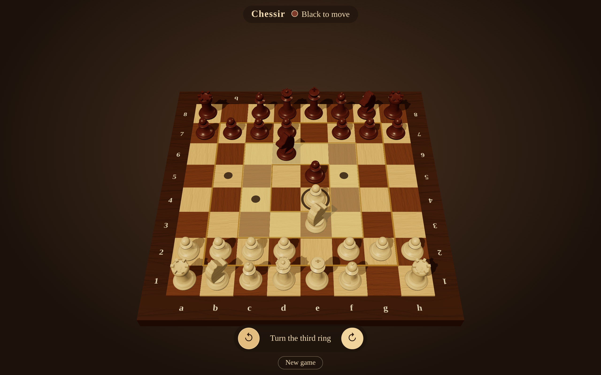
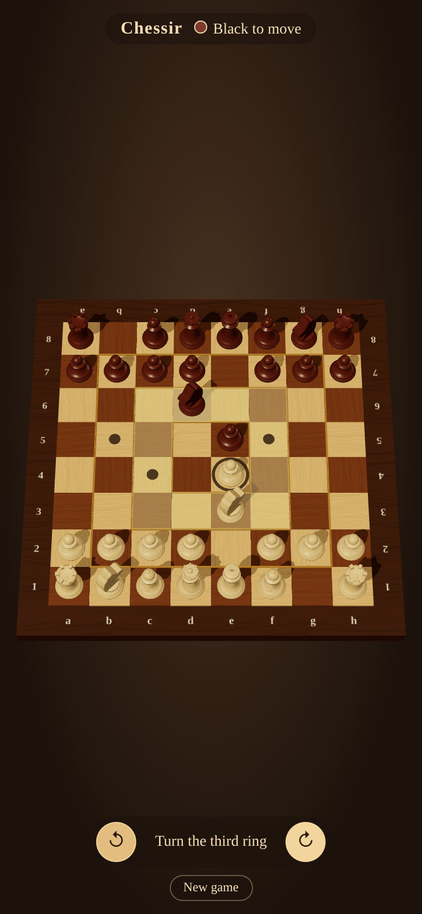
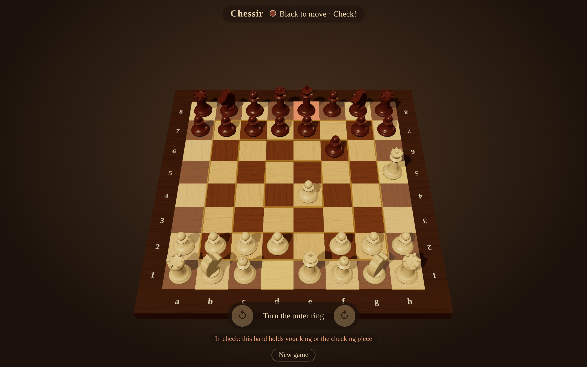

# Chessir

Chess where the board itself can turn. Rendered in the browser with [three.js](https://threejs.org/).

**Play it:** https://templarrr.github.io/chessir/



## Rules

All classic chess rules apply, plus one extra option. The board is split into four square
rings ("bands"): the outer ring of 28 squares, then 20, then 12, and the 4 central squares.
On your turn, instead of moving a piece you may rotate one band by one square in either
direction; every piece on that band travels with it.

While your king is in check you may not rotate a band that holds your king or the checking
piece. You may still escape check by rotating another band so that a piece lands between them.
As with any move, a rotation may never leave your own king in check.

Details that follow from the twist:

- Castling is allowed only if neither the king nor that rook has ever left its square, whether
  by a move or by riding a rotating band.
- En passant is possible only on the turn right after the double step.
- A pawn always moves toward the opponent's side. One carried onto its last rank by a rotation
  stays a pawn and cannot move forward until a rotation carries it off again; promotion happens
  only by moving there.
- An empty band cannot be rotated (that would be a "pass").
- The game ends in checkmate, or in a draw by stalemate, threefold repetition, the fifty-move
  rule, or when only the two kings remain.

## How to play

Hot-seat: both players share one screen.

- Tap one of your pieces to see where it can go (dots, or rings for captures), then tap the
  destination. Promotions ask which piece you want.
- Tap any square to select its band; use ↺ / ↻ at the bottom to turn that band one square
  counter-clockwise or clockwise (as seen from White's side). If the turn is not allowed, the
  reason appears under the buttons.
- Drag to orbit the camera, scroll or pinch to zoom.

| Phone                                                 | In check: the king's ring is locked                         |
| ----------------------------------------------------- | ----------------------------------------------------------- |
|  |  |

## Status

- [x] 3D board and pieces, scales to any window size
- [x] Piece moves and band rotation in the UI (hot-seat)
- [x] Rules enforcement (check, mate, special moves, draws)
- [ ] Computer opponent

## Development

Requires Node.js 22.12 or newer.

```sh
npm install
npm run dev      # local server with hot reload
npm run check    # lint + tests + production build
npm run format   # auto-fix lint and formatting
```

Keep `docs/screenshots/` up to date whenever the look or the UI changes; the README and pull
requests show them.

Code style is enforced by [ESLint](https://eslint.org/) (correctness) and
[Prettier](https://prettier.io/) (formatting); CI fails if either complains.

## Code layout

- `src/game/` holds the rules and game state as plain data with no three.js or DOM
  dependencies, so it can be unit-tested and used by a computer player.
  `src/game/rules.js` holds move generation, the rotation rules and game-end detection.
- `src/render/` turns that state into a three.js scene.
- `src/ui/` holds the human player, which turns taps and button presses into actions.
- `src/game/actions.js` defines the two kinds of turn (`move`, `rotate`) and the `Player`
  contract: anything with `chooseAction(state) => Promise<Action>`. Human input and a future AI
  player both plug in through it.

## Deploying to GitHub Pages

Every push to `main` is built and published by `.github/workflows/deploy.yml`. One-time setup:

1. Open the repository on GitHub, go to **Settings → Pages**.
2. Under **Build and deployment → Source**, choose **GitHub Actions**.
3. Merge to `main` (or run the workflow from the **Actions** tab). The site appears at
   `https://<user>.github.io/chessir/`.
